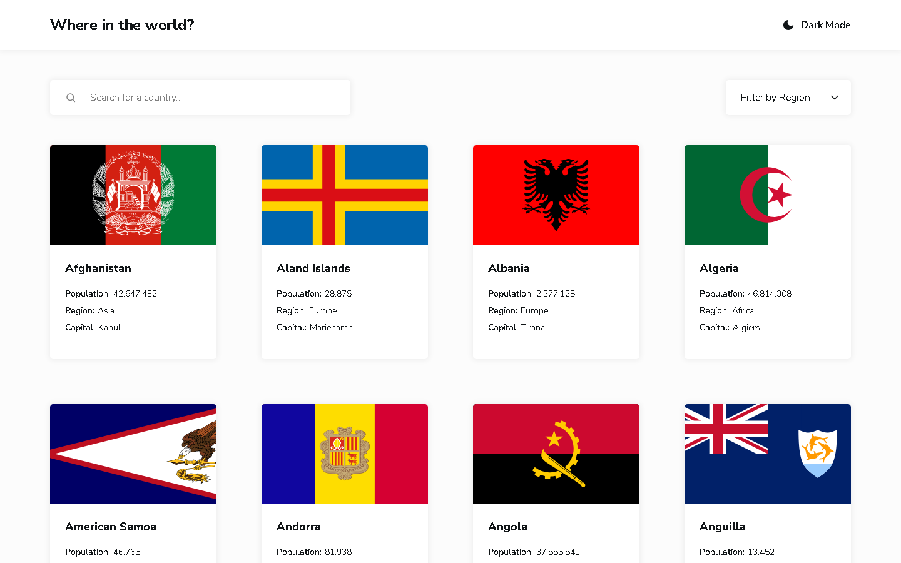
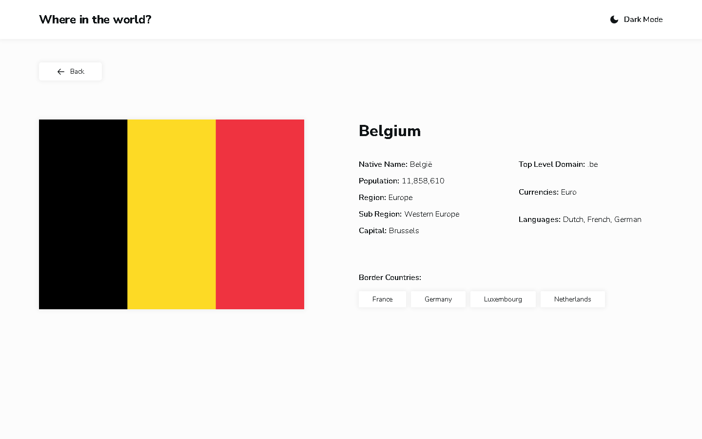
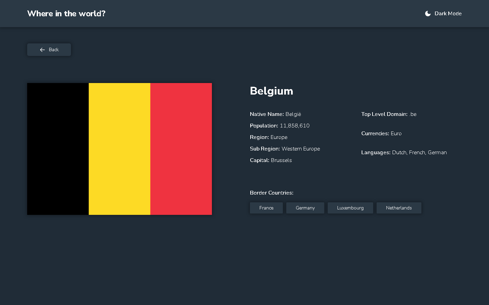

# REST Countries API with colour theme switcher

A country explorer built on the Frontend Mentor challenge. Browse 250 countries, search them by
name or native name, filter by region, open a country's detail page and jump to its neighbours —
in light or dark mode.

**Live demo:** https://rest-countries-api-fawn-delta.vercel.app



## Features

- All 250 countries rendered from `public/data.json`.
- Search by **name and native name**, diacritic-insensitive (`aland` finds Åland Islands).
- Region filter built from the data itself, so all eight real regions are reachable.
- Detail page with native name, population, region, subregion, capital, top-level domain,
  currencies, languages and border countries.
- Border countries are links, so you can walk from Belgium to France to Germany.
- Light/dark theme that follows the OS until you choose, then remembers your choice.
- Deep links such as `/country/BEL`, including a working Back button when the page is opened
  directly.

| Light | Dark |
| --- | --- |
|  |  |

## Tech stack

React 19 · TypeScript · Vite · React Router · vanilla CSS with custom-property tokens.
Tests: Vitest + Testing Library (unit/integration) and Playwright + axe-core (end-to-end).

## Architecture

```
src/
  routes/      Home, CountryDetail, NotFound
  components/  Header, SearchField, RegionFilter, CountryGrid, CountryCard, Flag,
               BorderLinks, BackButton, state components
  lib/         countries (fetch + cache), selectors (pure), format, normalize
  hooks/       useCountries, useTheme
  styles/      tokens.css, base.css
```

### Decisions worth knowing

**Data is fetched, not imported.** `lib/countries.ts` keeps one module-scoped promise, so the
first view pays for the download and every later view (including the detail page) reuses it. A
failed request clears the cache before rethrowing — otherwise a transient network error would
poison the cache and the Retry button would replay the same rejection forever.

**Normalisation at the boundary.** `data.json` omits `capital` in 5 entries, `currencies` in 1 and
`borders` in 85 — they are missing keys, not empty arrays. `normalizeCountries()` converts
`RawCountry` into a `Country` where every field is present, so no component needs `?? []` guards.

**Search state is local, and that is a conscious trade-off.** Keeping `q` and `region` in
`useState` inside `Home` keeps the components simple, but the home page remounts after Back, so
the filters and scroll position are lost. Putting them in search params would fix that and make
filtered views shareable; it is the first refactor I would make next.

**Regions come from the data.** Hard-coding the five regions in the design would orphan
Antarctica (`Polar`), Bouvet Island (`Antarctic Ocean`) and Heard Island (`Antarctic`). The select
is populated from `getRegions()`, so those three stay filterable.

**A native `<select>`.** The design shows a custom dropdown; a styled native select keeps keyboard
and screen-reader behaviour for free. `<meta name="color-scheme">` plus `color-scheme` per theme
makes its popup follow dark mode.

**No flash of the wrong theme.** An inline script in `<head>` resolves
`localStorage.theme ?? prefers-color-scheme` and sets `data-theme` on `<html>` before the bundle
runs. React then reads what is already applied instead of deciding on mount.
`e2e/theme.spec.ts` proves it by blocking the JS bundle and asserting the attribute is already set.

**One `<h1>` per page.** The site name in the header is a paragraph with a link; the page owns the
heading (`All countries` visually hidden on the home page, the country name on detail), and cards
are `<h2>`. No skipped heading levels.

**No debounce.** Filtering 250 strings is effectively free; a debounce would only add latency.
`useDeferredValue` keeps typing responsive by deprioritising the grid re-render instead.

## Accessibility

- axe-core reports zero violations on the home page (light and dark) and on the detail page.
- Lighthouse on the production build: 100 accessibility, 100 best practices and 100 SEO on both the
  home page and a country detail page.
- Keyboard order follows the visual order (site link → theme toggle → search → region → cards) and
  links open with Enter, with a visible 2px focus ring.
- Flags are decorative (`alt=""`) because the country name is always adjacent text, so screen
  readers do not hear "Germany, Germany".
- Result counts are announced through an `aria-live="polite"` region.
- The theme toggle exposes `aria-pressed` and keeps a stable accessible name.
- Visible `:focus-visible` rings on cards, chips, buttons and links; `prefers-reduced-motion` is
  respected.

## Getting started

```bash
npm install
npm run dev        # dev server
npm run build      # typecheck + production build
npm run preview    # serve the production build
```

## Tests

```bash
npm test           # Vitest + Testing Library, 60 tests
npm run e2e        # Playwright, 19 tests (builds and serves the app first)
npm run lint
```

The end-to-end suite covers the flows most likely to break: search + region filtering,
home → detail, detail → border country, opening `/country/FJI` directly then pressing Back, a
failed `data.json` request followed by Retry, an unreachable flag CDN, and axe scans of the home
page (both themes), a country with no borders, the 404 page and the error state.

## Deployment

The app fetches `${import.meta.env.BASE_URL}data.json`, and `BrowserRouter` uses the same value as
its `basename`, so a subpath deploy works without code changes.

- **Vercel / Netlify:** `vercel.json` and `public/_redirects` rewrite unknown paths to
  `index.html`, so `/country/BEL` survives a hard refresh. Static files (`data.json`, the JS
  bundle) are served before those rewrites.
- **GitHub Pages:** set `base: '/<repo-name>/'` in `vite.config.ts` and run
  `npm run build:pages`. The build copies `dist/index.html` to `dist/404.html`, which is Pages'
  fallback for deep links.

The live site runs on Vercel at **https://rest-countries-api-fawn-delta.vercel.app**, built from
`main` with the config above: `/country/BEL` returns the app and survives a hard refresh, and
`data.json` is served as a static file before the rewrite. Lighthouse on the deployed URL reports
100 accessibility, 100 best practices and 100 SEO.

## Known limitations

- Reloading a detail page while offline shows the error state; there is no service worker cache.
- Flags come from flagcdn.com; if it is unreachable the card keeps its aspect ratio and shows an
  empty placeholder instead of collapsing the grid.
- The grid renders all matching cards at once. With 250 items that is fine; a much larger dataset
  would want windowing.
